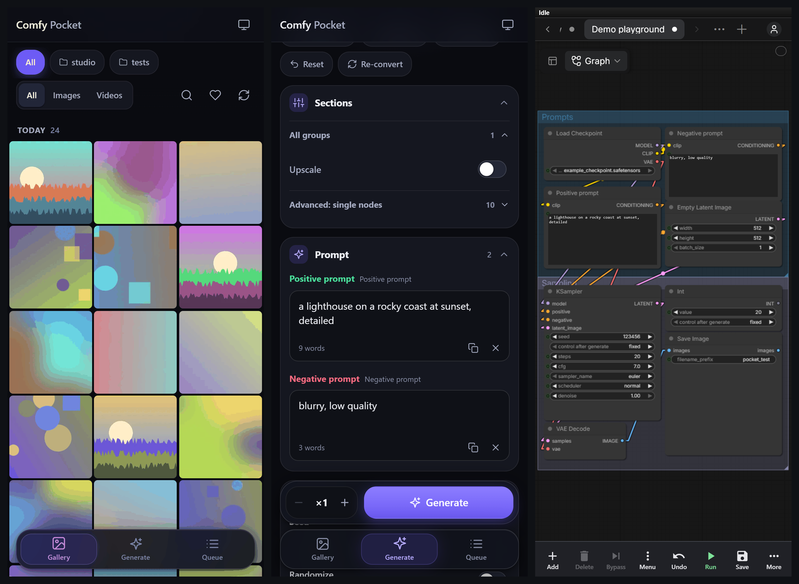
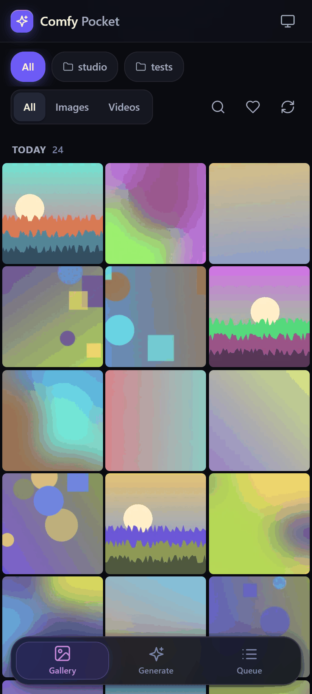
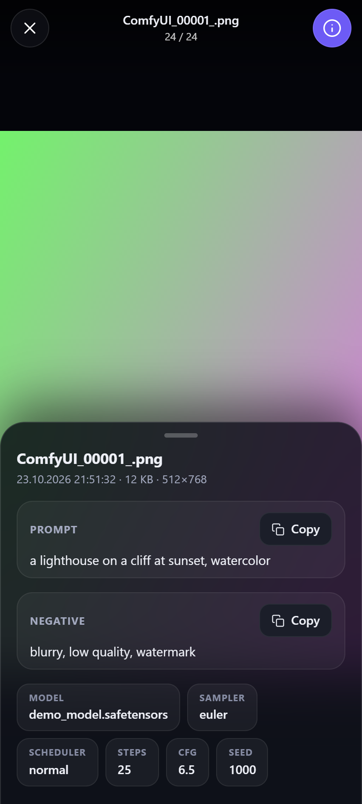
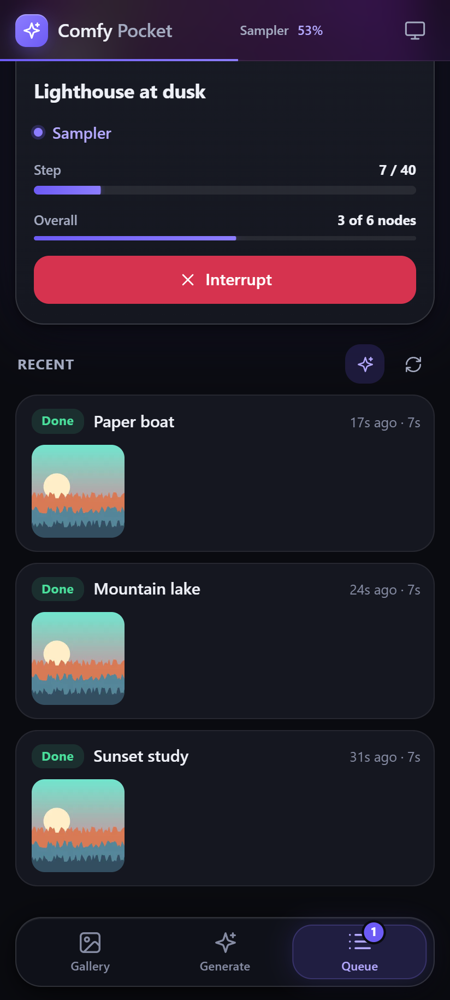
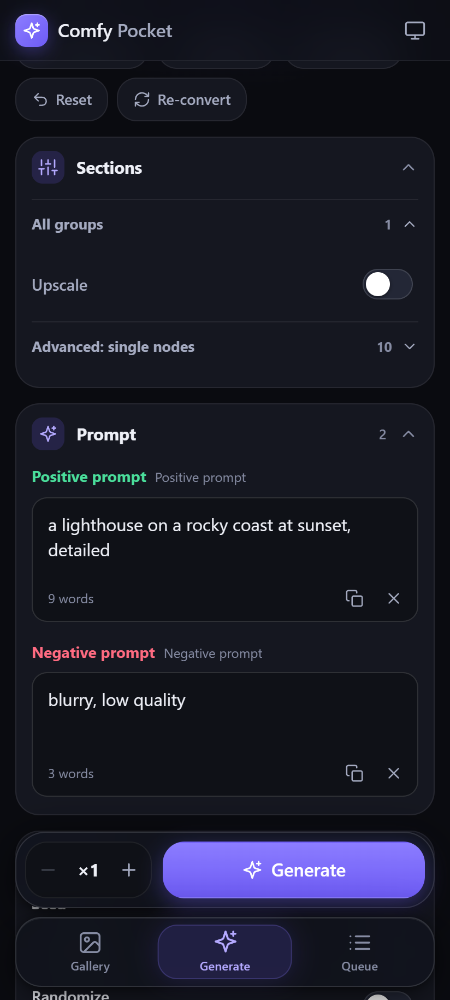
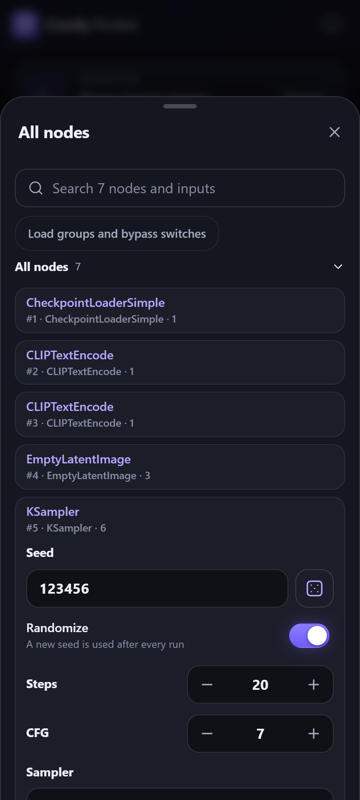
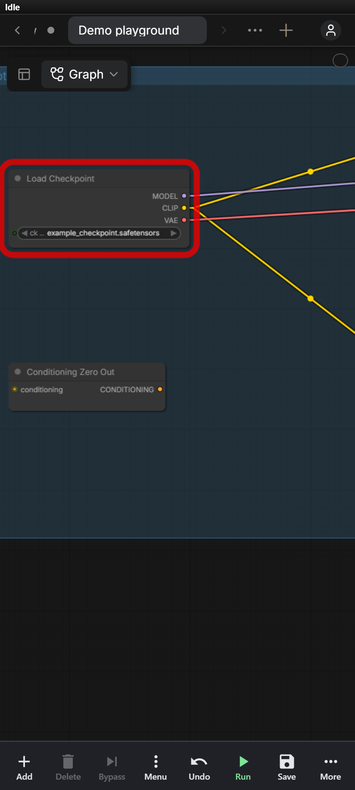

# ComfyUI Pocket

ComfyUI on your phone. A phone app for browsing and generating, plus the real node editor reworked for touch.



I built this because the desktop ComfyUI was close to unusable on my phone. Panning stuttered, a finger held on the canvas opened a right-click menu, and running a saved workflow meant fighting a UI made for a mouse. Pocket installs as a custom node and gives you two ways in:

- **The phone app** at `/pocket/`. Gallery, live queue, and a Generate screen that reads your saved workflows and builds a form from them.
- **Canvas mode** at `/pocket/canvas`. The actual ComfyUI editor with a phone layer on top, so every node and custom widget behaves as it does on the PC. On a mid-range Android phone, panning went from about 16 fps to about 70 fps.

## Install

Clone into `custom_nodes` and restart ComfyUI:

```
cd ComfyUI/custom_nodes
git clone https://github.com/Klark61/comfyui-pocket
```

ComfyUI-Manager's "Install via Git URL" works with the same URL. There's nothing to pip-install. Pocket uses the aiohttp and Pillow that ComfyUI already ships with.

Your phone has to reach the PC, so start ComfyUI with `--listen`:

```
python main.py --listen
```

Then open `http://<your-PC-IP>:8188/pocket/` on the phone. "Add to Home screen" makes it open like an app. A phone that opens ComfyUI's normal address gets redirected to `/pocket/`. Add `?desktop=1` to the URL if you want the desktop UI anyway.

Tested with ComfyUI 0.42 and frontend 1.55, in Chrome on Android. Older versions may work. I haven't checked. Python 3.10 or newer.

## The phone app

<p>
  
  
  
</p>

**Gallery.** Your outputs in a grid, with folders, favorites and search. Tap an image for a fullscreen viewer: swipe between images, pinch to zoom, read the prompt and settings, share or download. Remix sends an image's workflow back to Generate with the same settings.

**Queue.** Progress and live previews for every job, including the ones you started on the desktop. You can cancel, interrupt or clear jobs. Text that nodes produce, such as the prompt a prompt-writer LLM came up with, shows up here with a copy button.

**Generate.** Pick a saved workflow, a recent run, a preset or an image to remix. Pocket loads the real ComfyUI frontend in a hidden frame and converts the graph the same way the desktop Queue button does, then shows the parts you'd want to change: prompts, seed, steps, CFG, sampler, scheduler, size, models and LoRAs (rgthree Power Lora Loader included). Anything else can be pinned. The first load of a session takes 20 to 30 seconds. After that it's cached.

<p>
  
  
</p>

The Generate screen covers most of what I used to do on the desktop:

- Groups show up as on/off toggles, the way rgthree's Fast Groups Bypasser and Muter work. A toggle re-converts the workflow in about a second and keeps your edits. Single nodes can be bypassed too.
- Switch nodes (ComfySwitchNode, Impact switches, boolean primitives) become toggles at the top.
- LoadImage inputs take a photo from the camera or the library. Large or HEIC photos are converted to JPEG on the phone first. You can also reuse one of your outputs.
- "All nodes" lists every node grouped like the workflow, with search, and lets you edit any input.
- Each seed follows the workflow's own "control after generate" setting (randomize, fixed, increment). Your toggle wins if you change it.
- API-format workflow files load directly. A broken file gets an error that says what's wrong with it.

## Canvas mode



Switch Generate from Simple to Canvas, or tap "Open in canvas" in the workflow list. You get the real editor, so custom nodes and their widgets work. Save writes to the same workflow file the PC uses, and switching back to Simple reloads it with your changes.

Two fingers move and zoom the view. While your fingers are down, the picture is slid around on the GPU and redrawn once you let go, so you might see blank edges or a bit of blur for a moment. One finger works on the graph: drag a node, drag a group by its title, or drag from an output dot to an input dot to connect. Holding a finger still doesn't open a menu. The Menu button does that, for the selected node or for the canvas.

The toolbar has Add, Delete, Bypass, Undo, Run, Save and Menu. The ⋯ button holds Mute, Redo, Fit view, Simple and Settings. In Settings you can make one finger on empty canvas pan or box-select instead of doing nothing, and turn on a long-press menu if you want one.

Canvas mode keeps its phone tweaks on the phone and never touches your desktop settings. To load faster it only loads the extensions your workflow needs. If a node you add looks plain, ⋯ → Full extensions reloads with everything. Unsaved edits survive a reload.

[docs/performance.md](docs/performance.md) has the measurements and what each change was worth.

<br clear="right">

## Security

ComfyUI has no login, and neither does Pocket. Use it on your home network, or behind a VPN or a reverse proxy that asks for a password. Don't forward port 8188 to the internet.

Deleting an image moves it to `data/trash` inside the node folder. ComfyUI doesn't serve that folder. Files there are erased for good after 30 days, which you can change with `COMFYUI_POCKET_TRASH_DAYS`. As with stock ComfyUI, anyone on your network can watch job progress.

## Where things are stored

- `user/default/comfyui-pocket/`: favorites, workflow snapshots and presets
- `custom_nodes/comfyui-pocket/data/trash/`: deleted images
- `custom_nodes/comfyui-pocket/cache/thumbs/`: thumbnails, capped at 300 MB (`COMFYUI_POCKET_THUMB_CACHE_MB`)

## Troubleshooting

**The phone can't connect.** Check that ComfyUI was started with `--listen`, that the phone is on the same Wi-Fi, and that your firewall allows TCP port 8188. On Windows that means an inbound rule.

**Generate takes a while the first time.** That's the hidden frame loading the ComfyUI frontend. It happens once per session.

**A node looks plain in Canvas mode.** Its extension wasn't loaded. Use ⋯ → Full extensions.

## Development

Unit tests don't need ComfyUI running:

```
node tests/test_fields.mjs
node tests/test_sections.mjs
node tests/test_nodes.mjs
node tests/test_gestures.mjs
node tests/test_canvas_prefs.mjs
node tests/test_storage_migrate.mjs
python -m pytest tests
```

The browser checks (`check_*.mjs`, `e2e_*.mjs`, `perf_canvas.mjs`) drive Chrome against a running ComfyUI using the sample workflows in `tests/fixtures/`. `e2e_scenarios.mjs` queues real jobs on your GPU. [tests/README.md](tests/README.md) explains the setup and the `COMFY_ROOT`, `WF_DIR` and `CHROME` variables. `tests/make_screenshots.mjs` rebuilds the images in this README from generated demo content.

Issues and pull requests are welcome. Please run the unit tests first.

## License

MIT, see [LICENSE](LICENSE). Pocket bundles Preact (MIT) and htm (Apache-2.0); details in [THIRD_PARTY_NOTICES.md](THIRD_PARTY_NOTICES.md).
